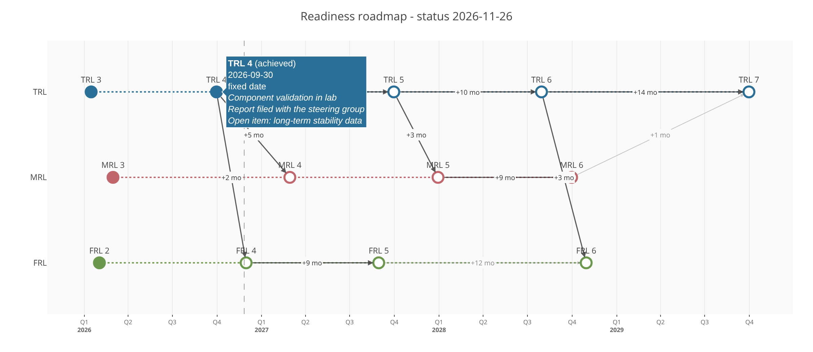
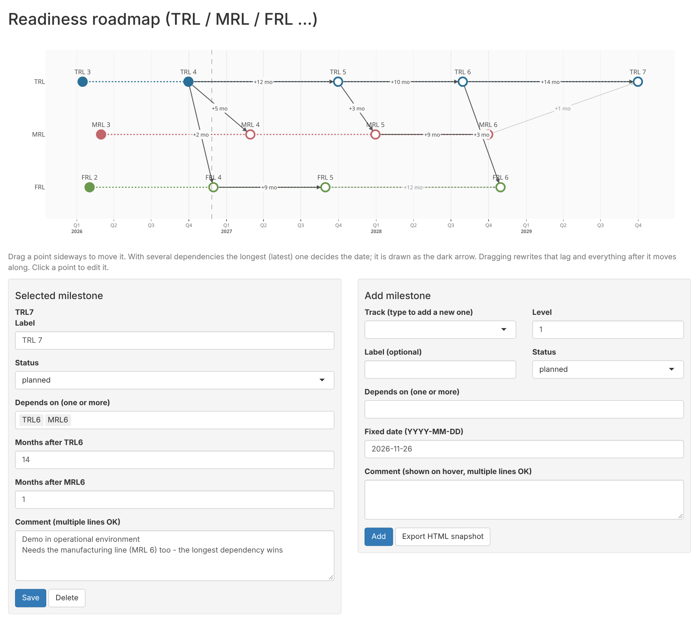

# roadmappeR 
[](https://lifecycle.r-lib.org/articles/stages.html#experimental)
[](https://github.com/VJGeiger/roadmappeR/actions/workflows/r.yml)
[](https://opensource.org/licenses/MIT)
[](https://github.com/VJGeiger/roadmappeR/releases)
[](https://github.com/VJGeiger/roadmappeR)
[](https://github.com/VJGeiger/roadmappeR)


Simple tool for start-ups to first define a roadmap in their terms by setting readiness levels.

- Milestones live inside a plain .csv-file.
- A milestone is either a fixed date or x months after one or more other
  milestones.
    - Longest milestone is displayed.
- Interactive timeline with quarterly ticks and multiline hover comments to highlight information.
- A shiny app to drag milestones, edit, comment and add tracks.
- It is possible to make a standalone, hover-only HTML snapshot of the current status.

## Installation

```R
# install.packages("remotes")
remotes::install_github("VJGeiger/roadmappeR")
```


## Usage

```R
library(roadmappeR)

# start with a copy of the example data
file.copy(roadmap_example(), "milestones.csv")

run_roadmap("milestones.csv")                         # interactive
export_snapshot("milestones.csv", "snapshot.html")    # standalone HTML

# or work in code
ms <- read_milestones("milestones.csv")
plot_roadmap(ms)
```

See `?"milestones-format"` for the csv columns.

## Example

`plot_roadmap()` on the example data: one lane per readiness track, dependencies
as arrows (the dark arrow is the longest one), and a multiline comment on hover.



`run_roadmap()` opens the same plot in the app: drag a point to move it, click a
point to edit its dependencies and comment, or add milestones and tracks.




---

## Contributing

Issues and pull requests welcome. Please open an issue before starting
significant work so we can discuss the approach first.
